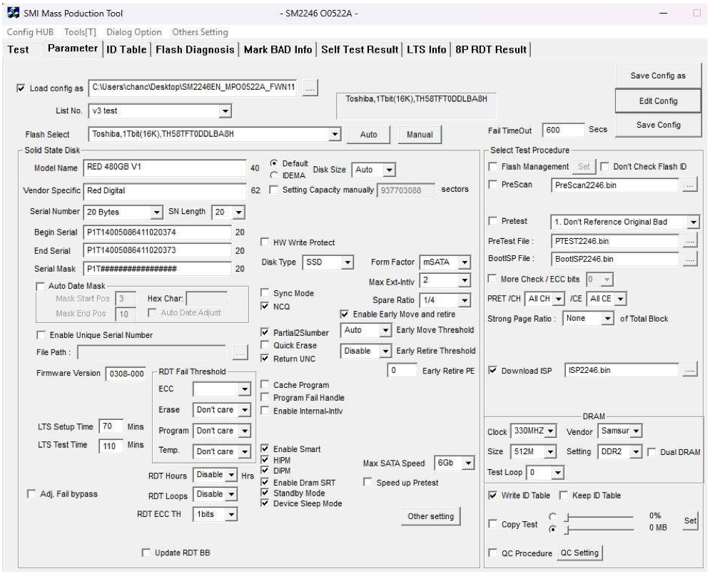

  

# MP Tool Guide

## What MP tools do

Mass Production tools initialize an SSD's firmware and NAND configuration and can change its identity fields. They are specific to controller and NAND combinations; the wrong package or DRAM settings can leave a drive unusable. This procedure destroys the SSD's existing data.

---

## Step 1: Identify controller, NAND, and DRAM

1. Connect the test SSD and record its original model, serial, and firmware using CrystalDiskInfo.
2. Inspect controller and NAND markings, or consult a teardown for the exact hardware revision. Example markings from the PDF are **SM2246EN** and **TH58TFT0DDLBA8H**; these are examples, not settings for every drive.
3. Identify the DRAM part number and look up its manufacturer, capacity, generation, and rated clock.
4. If a candidate MP tool supports non-programming detection, compare its detected controller/NAND with your notes. Rebranded NAND may require detected flash IDs to identify correctly.

Do not start programming while hardware identification is unresolved. CrystalDiskInfo firmware clues alone are not sufficient.

---

## Step 2: Find a matching package

The PDF points to the [SMI archive at usbdev.ru](https://usbdev.ru/files/smi/), with flashboot.ru, elektroda.com, and mydigit.cn as additional research leads. These are source-listed third-party resources, not an endorsement or assurance of package availability, authorization, or safety. No restricted packages are redistributed here.

1. Locate your controller family, using browser translation if needed.
2. Match the **exact NAND support**, not just the controller name.
3. Inspect package documentation and retain its version and origin in your notes.
4. Extract the archive with an appropriate archive utility. Typical contents include an MP tool `.exe`, configuration files, and firmware files.

The PDF's example package is `SM2246EN_MPO0522A_FWN11_Toshiba_1Tbit16K.rar`. The name encodes a controller, tool version, firmware, and NAND family; it does not establish compatibility with your drive. The source suggests trying a newer compatible build first and older compatible builds if necessary, without substituting a mismatched NAND package.

Run unfamiliar utilities on a dedicated test host. Do not treat an antivirus alert as proof of a false positive or disable protection simply to continue.

---

## Step 3: Connect and detect

Follow the [Hardware Guide](03-hardware-guide.md). Run the matched tool with administrator privileges, close other disk utilities, and use **Search / Scan** to locate the intended SSD. Do not initialize it in Windows. Try ROM mode only if normal detection fails and you have board-specific recovery documentation.

---

## Step 4: Configure the identity and capacity mode

Open **Parameter**, **Edit Config**, or **Config HUB**, depending on the tool version. Some SMI tools use two spaces as a configuration password; this is a convention noted in the repository's REDMAG guide, not a confirmed requirement for every MINIMAG tool build.

| Parameter | Setting |
| --- | --- |
| Model Name | `RED 480GB V1` |
| Vendor Specific | `Red Digital ` — include one trailing space |
| Begin Serial / End Serial | Your unique `P1T1400508641101XXXX` value, the same in both fields |
| SN Length | `20` |
| Firmware Version | `0308-000` |
| Disk Size | `Auto` |
| Capacity selector | `Default`, not `IDEMA` |
| Setting Capacity manually | Unchecked |

Model and vendor fields are typically in the upper-left “Solid State Disk” section; firmware is lower-left. The numbers beside identity fields may indicate field width rather than content to enter. The source notes that serial and reported firmware requirements remain unconfirmed.

### Configuration figure from the PDF

*Source: supplied `minimag-guide.pdf`, page 9, Figure 1. This shows an example SM2246EN configuration, not universal NAND or DRAM settings. Use the textual profile for serial entry: the screenshot's Begin/End Serial values differ from each other and from the written example. Its greyed sector-count field does not replace the separate Linux step.*

### Configure DRAM for the actual chip

Set **Clock**, **Vendor**, **Size**, and **Setting** (memory type) to match the identified DRAM and the tool's documented units. The source lists example clocks of 330/400/500 MHz and sizes of 256M/512M; do not copy those values or the screenshot's DRAM settings without verifying your hardware.

The PDF says its MP tool does not auto-detect DRAM configuration. Incorrect values can cause programming failure, instability, or poor performance. Keep NAND-specific Flash Select, ECC, Pretest, and similar settings at the matched package's defaults unless documentation for that hardware justifies a change.

Save the configuration and retain a backup with **Save Config as** if available. Review it before starting.

---

## Step 5: Program and verify identity

1. Return to **Test** and verify the intended drive occupies the expected port/slot.
2. Confirm stable power and that the SSD contains no needed data.
3. Click **Start / Run**. The tool may erase NAND, write firmware and identity, scan blocks, and initialize the controller.
4. Wait for completion without unplugging, closing the tool, or powering off. The source reports approximately **1–30+ minutes**, depending on settings.
5. Require a final **Pass** result. If it fails, capture the error and use [Troubleshooting & Recovery](07-troubleshooting-and-recovery.md).
6. Safely disconnect or power down, reconnect, and verify the model, reported firmware, and chosen serial in CrystalDiskInfo. Check the saved vendor field as well.

A Pass result establishes neither correct capacity nor camera reliability. The drive may still expose its native size. Continue with the Linux sector-count step before camera testing.

---

Prev: [Capacity Overview](04b-capacity-overview.md)  
Next: [Linux Sector Count Guide](06-linux-sector-count-guide.md)
