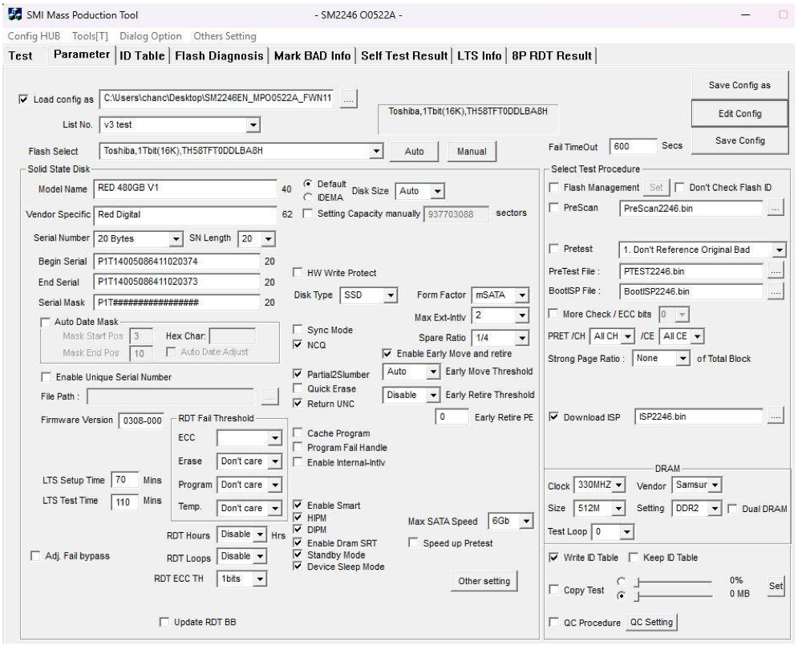

<p align="center">
  
</p>

# openMAG MINIMAG Guide

This guide is adapted from the PDF shared by [u/Educational_Sand_726](https://www.reddit.com/user/Educational_Sand_726/) in the r/RedCamera post [“MINI-MAG: How to use your own SSD”](https://www.reddit.com/r/RedCamera/comments/1sbjlgn/minimag_how_to_use_your_own_ssd/). Credit for the original guide goes to its creator; openMAG has reworded and reorganized it for this repository. This adaptation does not imply the creator's endorsement.

If the original creator would like this adaptation or its reproduced figure removed, please [open an issue](https://github.com/openmag-project/openmag/issues) so the maintainers can arrange removal. This note does not grant permission to reuse the original material or change its licensing.

Single-page edition. [Chapter contents and source coverage](README.md).

## Table of Contents

- [Overview](#overview)
- [SSD Guide](#ssd-guide)
- [Hardware Guide](#hardware-guide)
- [MINIMAG Validations Overview](#minimag-validations-overview)
- [Whitelist Overview](#whitelist-overview)
- [Capacity Overview](#capacity-overview)
- [MP Tool Guide](#mp-tool-guide)
- [Linux Sector Count Guide](#linux-sector-count-guide)
- [Working Example](#working-example)
- [Troubleshooting & Recovery](#troubleshooting--recovery)
- [Quick Reference](#quick-reference)

---

## Overview

### Goal

Document the supplied guide's workflow for configuring a compatible SATA SSD as a **RED 480GB V1** MINI-MAG profile, from hardware identification through camera testing.

This guide separates SSD requirements, bench setup, camera validation, and programming so that each stage can be checked before proceeding.

---

### Scope and compatibility

The source PDF reports successful use on **RED DSMC2 cameras running firmware v7.4.1**, described there as current as of March 2026. That is the source's dated compatibility claim, not a statement about today's latest firmware or independent verification by openMAG. Compatibility with other camera models, firmware versions, capacities, and controller families is not established here.

The worked profile is **480GB**. The PDF's subtitle says “any SATA drive,” but its procedure requires a supported controller, matching NAND tooling, physical DRAM, sufficient native capacity, and suitable sustained performance. Acceptance by a camera does not establish recording reliability.

---

### What the workflow changes

A Mass Production (MP) tool initializes the SSD's firmware, NAND configuration, and identity fields. The source uses Silicon Motion (SMI) tools to set the model, vendor-specific string, serial, and reported firmware version. Linux `hdparm` then sets the visible sector count through the Host Protected Area (HPA).

The source describes model identity and capacity as the main camera checks. It also prescribes other identity fields, while explicitly noting that the serial and firmware requirements have not been confirmed. Treat this as a reported working profile rather than a complete analysis of camera validation.

**Programming erases the drive and can permanently damage it.** Use an expendable test SSD and back up any data before proceeding. Read the repository's [disclaimer](../../legal/DISCLAIMER.md), [liability limitations](../../legal/LIABILITY.md), and [educational-use statement](../../legal/EDUCATIONAL_USE.md).

---

### Guide map

- **SSD Guide**: controller, NAND, DRAM, form factor, and sustained-write requirements.
- **Hardware Guide**: Windows host, adapters, power, Linux USB, and recovery connections.
- **MINIMAG Validations Overview**: the reported identity profile and exact capacity.
- **MP Tool Guide**: identify hardware, select a tool, configure, program, and verify.
- **Linux Sector Count Guide**: set and verify the persistent visible capacity.
- **Working Example**: follow the 480GB workflow and record your own results.
- **Troubleshooting & Recovery**: diagnose detection, programming, capacity, and recording failures.
- **Quick Reference**: parameters, commands, and source links.

---

### Source and editorial notes

Adapted from the supplied 16-page `minimag-guide.pdf`, titled **RED 480GB MINI-MAG® SPOOFING — How to Use Any SATA Drive With Your DSMC2**. The PDF was found through the Reddit post credited at the beginning of this guide, where u/Educational_Sand_726 shared it with the community. Its configuration figure is reproduced in the MP Tool chapter. Repeated page footers and broken PDF numbering have been replaced by the repository's chapter navigation.

The port retains the source's profile and workflow while distinguishing reported results from unverified requirements. It corrects the HPA example's enabled/disabled interpretation, adds explicit drive identification and post-power-cycle verification, and does not carry forward the source's generic sleep/cable-unplug “unfreeze” procedure as a universal remedy. A DRAM chip is retained as a requirement of this workflow, without presenting it as a guarantee of speed or the only cause of dropped frames.

RED, MINI-MAG, and DSMC2 are trademarks of their respective owners. This project is not affiliated with or endorsed by RED; see [trademark disclosures](../../legal/TRADEMARKS.md).

---

## SSD Guide

### Supported hardware for this workflow

The source covers **Silicon Motion (SMI)** controllers such as SM2246EN, SM2258, and SM2259. A controller family name alone does not establish compatibility: the MP tool package must support the exact controller **and NAND combination**.

Other controller families, including Phison, Maxio, and Realtek, are mentioned in the PDF but are outside its worked procedure. Do not substitute their tools or settings into this workflow.

---

### Controller, NAND, and DRAM

An SSD contains several components that must be identified before programming:

- **Controller**: runs the firmware and manages communication and flash storage.
- **NAND flash**: stores the data; record the complete package part number and detected flash ID when available.
- **DRAM**: working memory used by the controller; record manufacturer, capacity, memory generation, and rated clock.

The PDF requires a physical DRAM chip and excludes DRAM-less/XT variants from its workflow. Confirm the actual hardware revision through chip markings, datasheets, or a documented teardown. A small chip's location or shape alone is insufficient identification.

DRAM presence does not guarantee sustained recording performance. Controller firmware, NAND, cache exhaustion, temperature, and power also affect results. The source's approximately **300 MB/s sustained** target is a screening guideline, not a verified requirement for every camera mode; it suggests looking for **400+ MB/s sustained** when performance is insufficient.

---

### Form factor and capacity

- **mSATA**: the source describes this as the original 480GB V1 MINI-MAG's internal form factor.
- **M.2 SATA**: requires a compatible M.2-to-mSATA adapter and enough physical space in the enclosure.
- **M.2 NVMe**: outside this workflow; PCIe/NVMe is not SATA. Check the interface specification rather than relying on connector keying alone.

The drive must natively expose at least **937,703,088 sectors of 512 bytes** after programming. HPA can hide capacity; it cannot create storage on a smaller drive. A model label or retail capacity is not enough to verify this requirement.

---

### Candidate checklist

- [ ] Controller and exact NAND identified.
- [ ] Matching MP tool package available before buying or programming.
- [ ] Physical DRAM present and its configuration known.
- [ ] SATA interface and a suitable enclosure/adapter.
- [ ] Sufficient native capacity for the 480GB profile.
- [ ] Sustained write performance tested beyond cache exhaustion and at operating temperature.
- [ ] Long recordings and read-back verification planned for the intended camera mode.

For more background on NAND, caching, and sustained writes, see the [REDMAG SSD Guide](../redmag/02-ssd-guide.md). Its general SSD concepts apply; its REDMAG identity and capacity settings do not replace the MINIMAG profile here.

---

## Hardware Guide

### Bench requirements

- Windows PC with administrator access; the source recommends Windows 10 or 11 for its Windows-only MP utilities.
- Compatible SATA SSD and an adapter that passes the tool's low-level ATA commands.
- Stable power, secure connectors, and a backup of any data on the SSD.
- Linux machine, or a spare **8GB or larger USB stick** for a live Ubuntu environment.
- DSMC2 camera and a MINI-MAG enclosure/adapter for final testing.

Creating a bootable USB erases that USB stick. Programming and camera formatting erase the test SSD. Identify each device before performing those operations.

---

### Adapter selection

The source reports these options:

1. **Direct motherboard SATA** through an mSATA-to-SATA or M.2 SATA-to-SATA adapter: its preferred connection for raw command access.
2. **USB-C MINI-MAG REDSTATION**: reported working for MP programming in the source, without an exact hardware revision or chipset.
3. **USB SATA dock**: dependent on the bridge and command passthrough. UASP or SAT support alone does not establish MP-tool or HPA support.

An adapter working for ordinary file transfers does not prove it supports programming, ROM-mode detection, or HPA commands. Those stages may need different connections. Record the adapter model and interface used at each stage.

---

### Connect for programming

1. For motherboard SATA, shut down and disconnect power before installing the SSD and adapter.
2. Seat and secure the SSD, then connect the adapter to the host.
3. Boot Windows, or connect the USB adapter as appropriate.
4. Confirm the intended SSD appears in **Device Manager > Disk drives**.
5. Cancel any Windows request to initialize the disk. Do not partition or format it for the MP tool.
6. Close Disk Management, CrystalDiskInfo, and other disk utilities before programming.

Use a direct port and stable power. If using a virtual machine, document the hypervisor and passthrough setup; disconnects can interrupt programming.

---

### ROM / ISP recovery mode

Some drives that cannot be detected normally may require ROM mode, also called ISP or safe mode. Try normal detection first.

Only use recovery pads documented for the **exact SSD model and PCB revision**. Disconnect power before attaching a jumper to those designated pads, then follow the board-specific instructions for applying power and releasing the jumper after detection. Pad locations and timing are not universal. Do not guess based on another board's photograph.

The source describes temporarily shorting documented ROM pads during power-up and releasing the short after the MP tool detects the controller. This is a recovery technique, not a prerequisite for every drive. Recovery is not guaranteed; see [Troubleshooting & Recovery](#troubleshooting--recovery).

---

### Software to prepare

- [CrystalDiskInfo](https://crystalmark.info/en/software/crystaldiskinfo/) for reported model, serial, and firmware. These fields can suggest hardware but do not reliably identify every controller, NAND, or DRAM chip.
- A controller/NAND-matched MP tool package; see [MP Tool Guide](#mp-tool-guide).
- [Ubuntu Desktop](https://ubuntu.com/download/desktop), with [Rufus](https://rufus.ie/) or [balenaEtcher](https://etcher.balena.io/) to create a live USB if needed.
- Linux `hdparm` for the separate capacity step.

No firmware binaries or MP tool executables are included in this repository. Follow the repository's [contribution rules](../../CONTRIBUTING.md) when sharing research.

---

## MINIMAG Validations Overview

### What validation means

Recognition, permission to format, and reliable recording are separate outcomes. Check and document all three.

The PDF describes a working **RED 480GB V1** identity and sector-count profile on DSMC2 firmware v7.4.1. It does not supply firmware-analysis evidence establishing every validation check, and it does not establish support for arbitrary SATA drives.

---

### Reported inputs

| Field | Profile in the source | Evidence limit |
| --- | --- | --- |
| Model | `RED 480GB V1` | Source identifies this as a whitelist match. |
| Vendor Specific | `Red Digital ` | Source requires one trailing space. |
| Serial | `P1T1400508641101XXXX` | Source recommends unique final digits; necessity is unconfirmed. |
| Reported firmware | `0308-000` | Source uses this value; necessity is unconfirmed. |
| Visible sector count | `937703088` | Source specifies an exact match for this profile. |

Changing the reported firmware string does not mean the drive runs original RED firmware. The MP tool programs its controller/NAND-specific firmware package.

The REDMAG overview mentions MINIMAG host-vendor logs `0x90` / `0x91`; the supplied PDF does not document those logs or a procedure for them. This port does not infer additional checks or log modifications from that mention.

---

### What to record

- Camera model and firmware version.
- SSD retail model, PCB revision, controller, NAND, and DRAM.
- Exact identity fields, preserving case and spaces.
- Visible/native sector counts, logical sector size, and adapter.
- MP tool version and saved configuration.
- Camera warnings verbatim, format result, recording settings, clip duration, and read-back outcome.

Do not infer reliability from recognition alone, or broader compatibility from a single test.

---

### This section's subpages

- [Whitelist Overview](#whitelist-overview): the single profile covered by the PDF.
- [Capacity Overview](#capacity-overview): sector arithmetic and the distinction from REDMAG configuration.

---

## Whitelist Overview

### Model covered by the source

The supplied PDF documents one target model:

```text
RED 480GB V1
```

Use exactly one space between `RED` and `480GB`, and one before `V1`. The source does not provide a complete MINIMAG whitelist or verified settings for other capacities.

---

### Other identity fields

| MP tool field | Value | Entry guidance |
| --- | --- | --- |
| Vendor Specific | `Red Digital ` | Capital R and D, one internal space, **one trailing ASCII space**. |
| Begin Serial / End Serial | `P1T1400508641101XXXX` | Replace the final four Xs with digits; use the same value for both on a single drive. |
| SN Length | `20` | Preserve the complete 20-character serial. |
| Firmware Version | `0308-000` | Reported identity string; not a firmware package filename. |

For example, `P1T14005086411010001` follows the source's serial pattern. Choose a unique suffix for each research drive and retain its original hardware identity in your notes. The source explicitly leaves the serial and firmware fields' necessity unconfirmed.

---

### Make the trailing space visible

The vendor value contains **12 characters**, including its final space. This notation makes the boundary visible:

```text
|Red Digital |
```

The vertical bars are delimiters for this illustration; **do not enter them** in the MP tool. Type `Red Digital`, then press Space once. A Markdown table or screenshot may not visibly distinguish that final space.

Do not reuse REDMAG's `Rev T` or `512GB` strings for this workflow. Follow the [MP Tool Guide](#mp-tool-guide) for where to enter these fields.

---

## Capacity Overview

### Exact target

The source specifies **937,703,088 visible sectors** for the `RED 480GB V1` profile, with 512-byte logical sectors:

```text
937703088 × 512 = 480103981056 bytes
                  ≈ 480.104 GB (decimal)
                  ≈ 447.132 GiB (binary)
```

A camera display near **447.1 GiB** is consistent with this target but does not prove the exact sector count. Record the device's numerical report.

---

### MP tool capacity versus Linux capacity

For this MINIMAG procedure the source says:

- **Disk Size: Auto**.
- Select **Default**, not IDEMA.
- Leave **Setting Capacity manually unchecked**.
- Program first, then use Linux `hdparm` to set the visible count.

This differs from the REDMAG MP Tool Guide's IDEMA selection. Do not copy that REDMAG setting into this profile. The PDF reports that manual sector-count configuration inside the MP tool can cause programming failure.

---

### Host Protected Area (HPA)

HPA limits the capacity exposed to the host. The SSD must already have at least the target native capacity; reducing the visible size cannot make a smaller drive larger. A partition resize or filesystem format does not set the drive's ATA visible sector count.

The Linux [hdparm manual](https://man7.org/linux/man-pages/man8/hdparm.8.html) defines `-N` as the visible sector count setting; `p` requests persistence. Its report gives visible/native counts. When visible is below native, the difference is hidden by an **enabled** HPA. The PDF's sample labels that case “disabled”; compare the numerical values instead.

Changing this limit can make existing data inaccessible. Follow the [Linux Sector Count Guide](#linux-sector-count-guide) on an expendable, unmounted drive and verify again after a full power cycle.

---

## MP Tool Guide

### What MP tools do

Mass Production tools initialize an SSD's firmware and NAND configuration and can change its identity fields. They are specific to controller and NAND combinations; the wrong package or DRAM settings can leave a drive unusable. This procedure destroys the SSD's existing data.

---

### Step 1: Identify controller, NAND, and DRAM

1. Connect the test SSD and record its original model, serial, and firmware using CrystalDiskInfo.
2. Inspect controller and NAND markings, or consult a teardown for the exact hardware revision. Example markings from the PDF are **SM2246EN** and **TH58TFT0DDLBA8H**; these are examples, not settings for every drive.
3. Identify the DRAM part number and look up its manufacturer, capacity, generation, and rated clock.
4. If a candidate MP tool supports non-programming detection, compare its detected controller/NAND with your notes. Rebranded NAND may require detected flash IDs to identify correctly.

Do not start programming while hardware identification is unresolved. CrystalDiskInfo firmware clues alone are not sufficient.

---

### Step 2: Find a matching package

The PDF points to the [SMI archive at usbdev.ru](https://usbdev.ru/files/smi/), with flashboot.ru, elektroda.com, and mydigit.cn as additional research leads. These are source-listed third-party resources, not an endorsement or assurance of package availability, authorization, or safety. No restricted packages are redistributed here.

1. Locate your controller family, using browser translation if needed.
2. Match the **exact NAND support**, not just the controller name.
3. Inspect package documentation and retain its version and origin in your notes.
4. Extract the archive with an appropriate archive utility. Typical contents include an MP tool `.exe`, configuration files, and firmware files.

The PDF's example package is `SM2246EN_MPO0522A_FWN11_Toshiba_1Tbit16K.rar`. The name encodes a controller, tool version, firmware, and NAND family; it does not establish compatibility with your drive. The source suggests trying a newer compatible build first and older compatible builds if necessary, without substituting a mismatched NAND package.

Run unfamiliar utilities on a dedicated test host. Do not treat an antivirus alert as proof of a false positive or disable protection simply to continue.

---

### Step 3: Connect and detect

Follow the [Hardware Guide](#hardware-guide). Run the matched tool with administrator privileges, close other disk utilities, and use **Search / Scan** to locate the intended SSD. Do not initialize it in Windows. Try ROM mode only if normal detection fails and you have board-specific recovery documentation.

---

### Step 4: Configure the identity and capacity mode

Open **Parameter**, **Edit Config**, or **Config HUB**, depending on the tool version. Some SMI tools use two spaces as a configuration password; this is a convention noted in the repository's REDMAG guide, not a confirmed requirement for every MINIMAG tool build.

| Parameter | Setting |
| --- | --- |
| Model Name | `RED 480GB V1` |
| Vendor Specific | `Red Digital ` — include one trailing space |
| Begin Serial / End Serial | Your unique `P1T1400508641101XXXX` value, the same in both fields |
| SN Length | `20` |
| Firmware Version | `0308-000` |
| Disk Size | `Auto` |
| Capacity selector | `Default`, not `IDEMA` |
| Setting Capacity manually | Unchecked |

Model and vendor fields are typically in the upper-left “Solid State Disk” section; firmware is lower-left. The numbers beside identity fields may indicate field width rather than content to enter. The source notes that serial and reported firmware requirements remain unconfirmed.

#### Configuration figure from the PDF



*Source: supplied `minimag-guide.pdf`, page 9, Figure 1. This shows an example SM2246EN configuration, not universal NAND or DRAM settings. Use the textual profile for serial entry: the screenshot's Begin/End Serial values differ from each other and from the written example. Its greyed sector-count field does not replace the separate Linux step.*

#### Configure DRAM for the actual chip

Set **Clock**, **Vendor**, **Size**, and **Setting** (memory type) to match the identified DRAM and the tool's documented units. The source lists example clocks of 330/400/500 MHz and sizes of 256M/512M; do not copy those values or the screenshot's DRAM settings without verifying your hardware.

The PDF says its MP tool does not auto-detect DRAM configuration. Incorrect values can cause programming failure, instability, or poor performance. Keep NAND-specific Flash Select, ECC, Pretest, and similar settings at the matched package's defaults unless documentation for that hardware justifies a change.

Save the configuration and retain a backup with **Save Config as** if available. Review it before starting.

---

### Step 5: Program and verify identity

1. Return to **Test** and verify the intended drive occupies the expected port/slot.
2. Confirm stable power and that the SSD contains no needed data.
3. Click **Start / Run**. The tool may erase NAND, write firmware and identity, scan blocks, and initialize the controller.
4. Wait for completion without unplugging, closing the tool, or powering off. The source reports approximately **1–30+ minutes**, depending on settings.
5. Require a final **Pass** result. If it fails, capture the error and use [Troubleshooting & Recovery](#troubleshooting--recovery).
6. Safely disconnect or power down, reconnect, and verify the model, reported firmware, and chosen serial in CrystalDiskInfo. Check the saved vendor field as well.

A Pass result establishes neither correct capacity nor camera reliability. The drive may still expose its native size. Continue with the Linux sector-count step before camera testing.

---

## Linux Sector Count Guide

### Goal and preconditions

After MP programming, set the test SSD to **937,703,088 visible 512-byte sectors** using Linux `hdparm`. This is separate from partitioning or camera formatting.

**This operation changes persistent drive capacity and can make data inaccessible.** Use an expendable SSD with no needed data. Disconnect unrelated drives where practical, identify the target by model and serial, and unmount all its partitions. These commands are documentation examples; `/dev/sdX` must be replaced with the confirmed whole-drive device, never a partition such as `/dev/sda1`.

---

### Part A: Prepare a live USB

Skip to Part C if you already have a suitable Linux host.

1. Download an [Ubuntu Desktop ISO](https://ubuntu.com/download/desktop) and [Rufus](https://rufus.ie/) or [balenaEtcher](https://etcher.balena.io/).
2. Insert a spare USB stick of at least 8GB, with enough space for the chosen ISO. Creating the installer erases the stick.
3. In Rufus, select that USB device and the ISO. The source uses GPT/UEFI and ISO mode; use settings appropriate to your host and the selected image rather than forcing a filesystem the tool does not offer.
4. Confirm the selected USB device, start writing, and wait for **Ready**.

---

### Part B: Boot without installing

1. Connect the programmed test SSD and bootable USB.
2. Restart and open your computer's boot-device menu. The source gives examples such as ASRock/MSI F11, ASUS F8, Gigabyte/Dell/Lenovo F12, and HP F9; consult the host's instructions because keys vary by model.
3. Choose the USB's UEFI boot entry where appropriate.
4. Select **Try Ubuntu**, rather than installing over an existing system.
5. Open Terminal, for example with Ctrl+Alt+T. Ensure `hdparm` is available (`hdparm -V`); if missing, install it through the distribution's package manager before continuing.

---

### Part C: Identify and inspect the target

```sh
lsblk -o NAME,MODEL,SERIAL,SIZE,LOG-SEC,MOUNTPOINTS
sudo hdparm -I /dev/sdX
sudo hdparm -N /dev/sdX
```

Confirm the model and serial match your programmed SSD. **Do not select a drive by approximate size or drive letter alone**: device names can change and multiple drives may be similar sizes. Confirm the logical sector size is 512 bytes and the native count is at least `937703088`. If either condition fails, stop; this profile does not cover that device.

Before modification, unmount any mounted target partitions using the desktop's unmount control or `umount` with each confirmed partition path. Do not change the capacity of a mounted filesystem or the host's system disk.

---

### Part D: Set the persistent visible count

Only after confirming the target, run:

```sh
sudo hdparm -N p937703088 --yes-i-know-what-i-am-doing /dev/sdX
```

Here `-N` changes the visible count, `p` requests a persistent setting, and `/dev/sdX` identifies the whole SSD. The [hdparm manual](https://man7.org/linux/man-pages/man8/hdparm.8.html) warns that changing this limit risks data loss. Persistence and command support depend on the drive and connection; an error is not success.

Read back the result:

```sh
sudo hdparm -N /dev/sdX
```

The first value in the visible/native pair must be `937703088`. If the second is larger, the remaining sectors are hidden by HPA. Do not rely on the PDF's sample “HPA is disabled” label when interpreting unequal values.

---

### Part E: Verify persistence

1. Shut down Linux and fully power off/disconnect the test SSD.
2. Reconnect, identify its current device name again, and repeat the read-only checks in Part C.
3. Confirm the visible count remains `937703088`, with 512-byte logical sectors.
4. Save the output in your test notes, shut down, and remove the USB/SSD for camera testing.

If the bridge rejects HPA commands, try a suitable direct SATA connection. If the device is locked or reports a frozen condition, capture the exact error and consult controller-specific documentation; do not apply a generic cable-disconnection remedy. See [Troubleshooting & Recovery](#troubleshooting--recovery).

---

## Working Example

### Goal

Follow the source's 480GB profile and record reproducible results. **This page is a worksheet, not a new independently verified openMAG hardware test.** The PDF provides a configuration figure but no complete drive identification, camera logs, or recording-duration results for this port to reproduce.

---

### Bench details (fill in before testing)

| Item | Your test record |
| --- | --- |
| Date / researcher | To record |
| Camera / firmware | To record; source reports DSMC2 v7.4.1 |
| SSD retail model / PCB revision | To record |
| Controller / NAND part number and ID | To record |
| DRAM manufacturer / part / size / type / clock | To record |
| Native sectors / logical sector size | To record |
| Adapter for MP programming / Linux HPA | To record separately |
| Windows / Linux versions | To record |
| MP tool package / version / saved config | To record |

---

### 1) Identify the SSD and select a tool

Record the original identity, inspect controller/NAND/DRAM, and match the MP package to that hardware. Save identification output and chip photographs with your test notes. Follow [MP Tool Guide](#mp-tool-guide), Steps 1–3.

### 2) Configure the profile

Set model `RED 480GB V1`, vendor `Red Digital ` with its trailing space, reported firmware `0308-000`, and your unique 20-character serial. Leave capacity on Auto/Default with manual capacity unchecked. Configure DRAM from the actual chip specifications.

Review the [source configuration figure](assets/screenshots/01-mp-tool-parameters.png) for field locations, while using your own hardware's NAND and DRAM values. Save the configuration before starting.

### 3) Program and verify identity

Run the tool, wait for Pass, and reconnect the SSD. Record the resulting model, serial, and reported firmware. Save the tool log and configuration; a successful programming result is only one stage of the test.

### 4) Set and verify capacity

Follow the [Linux Sector Count Guide](#linux-sector-count-guide). Record visible/native counts before and after the change and again after a full power cycle. Require `937703088` visible 512-byte sectors.

### 5) Test in camera

1. With the equipment powered down, install the mSATA SSD in the MINI-MAG enclosure, or install the SATA M.2 drive through a suitable adapter. Seat and secure all connections.
2. Insert the assembled media into the DSMC2 camera and power on.
3. Check media status. The source reports an **S-SSD** display near **447.1 GiB**.
4. Format in camera; the source gives **Menu > Media > Format**, though menu labels may vary. Formatting erases existing content.
5. Record a short clip at a moderate data rate, then progressively test the highest settings you intend to use.
6. Watch for **Media too slow**, **Dropped frames**, and **Unsupported media** warnings; copy any messages verbatim.
7. Record several long clips beyond the SSD's fast-cache capacity. Play back and inspect footage on a computer, and repeat after power cycles and at operating temperature.

Do not infer recording reliability from an accepted identity, a successful format, or a short clip. Preserve the actual duration, settings, and observed limits of each test.

---

### Results summary (fill in)

- Status: **NOT TESTED / PASS / FAIL / PARTIAL / NEEDS RETEST**
- Identity verification:
- Visible/native sector counts and persistence:
- Camera recognition / format result:
- Resolution / frame rate / compression / data rate:
- Longest clip and total recorded duration:
- Temperature and power conditions:
- Warnings, stalls, or interruptions:
- Computer playback / read-back result:
- Evidence filenames and next experiments:

Keep your own screenshots and logs alongside the test report. No placeholder image links are included as if evidence already exists.

---

## Troubleshooting & Recovery

### MP tool does not detect the SSD

- Confirm the intended drive, administrator privileges, stable power, and correct controller/NAND package.
- Close CrystalDiskInfo, Disk Management, and other disk utilities.
- Try another direct USB port or an appropriate direct SATA connection.
- Check whether the bridge supports low-level commands; file-transfer support is insufficient.
- If normal detection still fails, consult the exact board's ROM/ISP procedure in the [Hardware Guide](#hardware-guide).

---

### Programming ends in Fail

Capture the exact error and tool log before changing settings. Recheck NAND support, DRAM configuration, and the saved Auto/Default capacity mode. An incompatible NAND package is one cause, but not the only possible cause.

The PDF suggests trying another build for the **same supported controller/NAND combination**. It also notes that some recovery packages require **Download ISP** and the matching ISP binary. Use package-specific instructions; do not load an unrelated binary or change undocumented flash settings by trial and error.

---

### Drive no longer enumerates

A drive may still be detectable in documented ROM/ISP recovery mode. Some USB bridges fail to expose a controller in this state; direct SATA may help. Recovery is not guaranteed.

The PDF mentions an SPI programmer as a last resort. That is outside this guide's worked procedure and requires board-specific electrical and firmware knowledge. Do not assume every SSD has an accessible, recoverable external boot flash.

---

### Camera rejects media or will not format

Check the profile in order:

1. Model exactly `RED 480GB V1`.
2. Vendor `Red Digital `, including its trailing space, in the saved configuration.
3. Visible sector count exactly `937703088`, verified after full power removal.
4. Source's reported firmware `0308-000` and selected serial format.
5. Camera model/firmware and physical enclosure connections.

Serial and reported firmware are part of the source profile; their necessity is unconfirmed. Reprogramming may be needed for incorrect identity settings; capacity-only errors belong in the separate Linux HPA step. Capture evidence before making further changes.

---

### Camera accepts media but drops frames

Acceptance does not prove adequate sustained speed. Verify the workflow's physical DRAM requirement, then check post-cache write performance, temperature, power, and adapter/enclosure stability.

The PDF suggests a lower data rate (higher compression or lower resolution) as a diagnostic and a faster sustained-write SSD if performance remains inadequate. Do not attribute every dropped frame to missing DRAM. Retest long clips and inspect footage on a computer after any change.

---

### hdparm fails or capacity does not persist

- Re-identify the device by model and serial; its Linux name may have changed.
- Confirm administrator privileges (`sudo`), an unmounted target, and sufficient native capacity.
- If a USB bridge rejects the command, use an appropriate direct SATA connection.
- Check the exact error against drive/controller documentation; HPA support and locking behavior differ.
- Verify the first number in `hdparm -N` output, then verify again after full power removal.

The PDF suggests `hdparm -Y` followed by disconnecting a SATA data cable for a “frozen” drive. This port does **not** provide that as a general recovery instruction: sleep, ATA security state, and HPA locking are different issues, and live cable removal depends on host support. Use documented hardware-specific recovery instead.

---

## Quick Reference

### Reported 480GB profile

| Parameter | Value |
| --- | --- |
| Camera compatibility reported by source | DSMC2, firmware v7.4.1; dated March 2026 |
| Model Name | `RED 480GB V1` |
| Vendor Specific | `Red Digital ` — one trailing space |
| Serial format | `P1T1400508641101XXXX` — unique final four digits |
| SN Length | `20` |
| Reported Firmware Version | `0308-000` |
| Disk Size / selector | `Auto` / `Default` |
| Setting Capacity manually | Unchecked |
| Linux visible sector count | `937703088` |
| Logical sector size | `512` bytes |
| Total visible bytes | `480103981056` |

Serial and reported firmware requirements are not confirmed by the source. DRAM and NAND settings must match the actual SSD; do not copy them from the example screenshot.

---

### Linux commands

**Identify the drive first.** Replace `/dev/sdX` with the confirmed whole SSD device; never infer the target from size alone. Unmount its partitions and follow the full [Linux Sector Count Guide](#linux-sector-count-guide) before changing capacity.

```sh
# Read-only identification and capacity inspection
lsblk -o NAME,MODEL,SERIAL,SIZE,LOG-SEC,MOUNTPOINTS
sudo hdparm -I /dev/sdX
sudo hdparm -N /dev/sdX
```

```sh
# Destructive-risk persistent capacity change: confirmed test SSD only
sudo hdparm -N p937703088 --yes-i-know-what-i-am-doing /dev/sdX
```

```sh
# Read back, then repeat after a full power cycle and re-identification
sudo hdparm -N /dev/sdX
```

---

### Workflow checklist

- [ ] Controller, NAND, and physical DRAM identified.
- [ ] Exact matching MP package and DRAM settings confirmed.
- [ ] Original identity recorded and all needed data backed up.
- [ ] Compatible SATA connection and stable power prepared.
- [ ] Identity set, Auto/Default capacity retained, configuration saved.
- [ ] Programming Pass and identity read-back recorded.
- [ ] Exact visible capacity verified before and after power removal.
- [ ] Camera recognition, in-camera format, long recordings, and computer playback tested.
- [ ] Results reported with camera firmware, recording settings, durations, and evidence.

---

### Source-listed software and references

- [SMI archive](https://usbdev.ru/files/smi/) — third-party package research lead from the PDF; no tools are bundled or endorsed here.
- [CrystalDiskInfo](https://crystalmark.info/en/software/crystaldiskinfo/).
- [Ubuntu Desktop](https://ubuntu.com/download/desktop).
- [Rufus](https://rufus.ie/).
- [balenaEtcher](https://etcher.balena.io/) — alternative USB writer mentioned by the source.
- [hdparm manual](https://man7.org/linux/man-pages/man8/hdparm.8.html) — supplemental reference for capacity semantics and command risks.

The source-to-chapter mapping is maintained in the [contents page](README.md).

---
